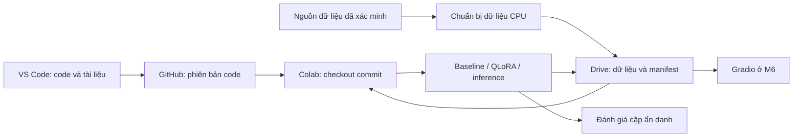

# Kiến trúc dự kiến

Đã triển khai `src/kids_story/data/` gồm M1 source sampling/xử lý/chia tập CPU và công cụ M2 review/near/SFT có cổng duyệt; chưa có metadata/SFT nguồn thực được phê duyệt. Model và demo dưới đây vẫn là dự kiến. Xem M1_REPORT/M2_REPORT để biết interface và giới hạn thực tế. Dùng module Python để notebook có thể gọi lại logic, tránh nhân bản giữa Colab và VS Code.

GitHub chưa được tạo, thư mục hiện chưa được khởi tạo Git. Drive và Colab chưa được kết nối. Mũi tên biểu diễn thiết kế; M1 mới chạy phần dữ liệu CPU.

| Ranh giới module dự kiến | Đầu vào → đầu ra | Phụ thuộc/vai trò |
|---|---|---|
| data/source | revision + cấu hình lấy mẫu → snapshot nhỏ + provenance | Truy cập mạng riêng, không cần khi xử lý fixture |
| data/process | JSONL cục bộ → bản chuẩn hóa + cờ + nhóm exact duplicate | CPU, không import trainer/CUDA |
| data/split | nhóm nguồn/nhóm trùng → train/validation + manifest | Seed cấu hình, ID ổn định |
| data/metadata, sft | dữ liệu được duyệt → hội thoại SFT | Chặn nhãn thiếu/chưa duyệt; M2 |
| prompting | metadata/input → messages | Cùng file prompt cho SFT, baseline, adapter, demo |
| training | manifest + config → adapter/checkpoint | Unsloth/QLoRA/TRL, M4 trở đi |
| inference | messages + cấu hình → output thô | Base hoặc base + adapter, M3 trở đi |
| evaluation | outputs + rubric → bảng chấm và báo cáo | Tách người chấm và ánh xạ ẩn danh |
| app | đầu vào giao diện → inference → hiển thị | Gradio, M6 |

Code, cấu hình nhỏ, prompt, tài liệu và bộ đề được quản lý bằng Git. Dataset lớn, checkpoint, adapter, tokenizer, output thô và bảng chấm có thông tin người chấm lưu Drive với quyền truy cập phù hợp; đường dẫn cấu hình, không hard-code. Manifest nhỏ đã loại thông tin nhạy cảm có thể đưa Git sau review. Không commit cache hoặc secrets.

Mỗi run ghi Git commit + dirty diff/hash, dataset/model revision bất biến, hash prompt, manifest, dependencies, GPU và config. Lưu run theo run_id, không ghi đè. Sau ghi artifact: kiểm tra danh sách file, checksum và thử nạp. Mất phiên: checkout commit cũ, dựng môi trường đã khóa, kiểm tra checksum, nạp đúng loại artifact. Adapter inference không thay thế checkpoint resume có optimizer/scheduler/RNG. Chi tiết trong COLAB_RUNBOOK và EXPERIMENT_LOG.
